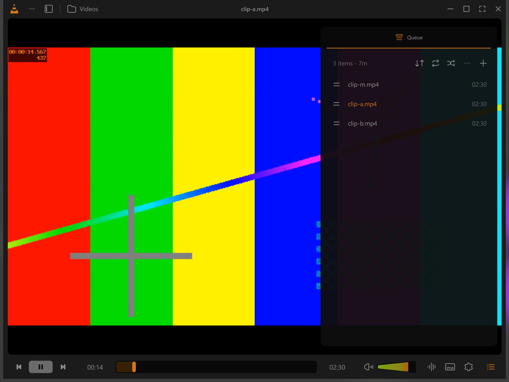
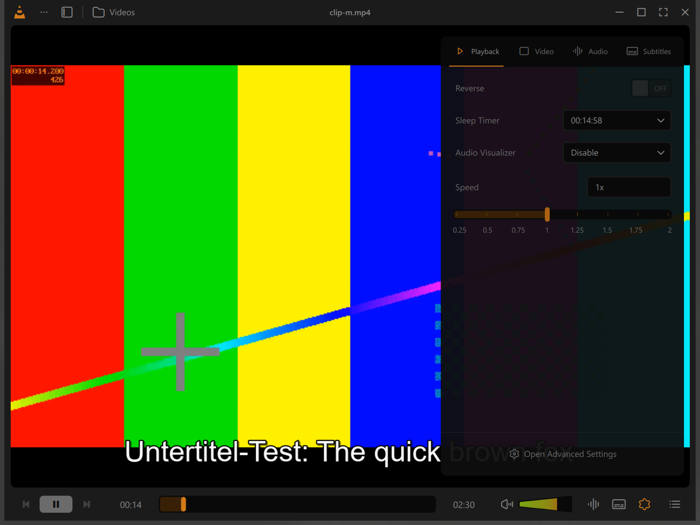

# VLC, redesigned (unofficial)

This fork builds the VLC interface redesign by
[Juxtopposed](https://juxtopposed.com) into VLC 4, in its Qt/QML interface.

- Video: [I Redesigned VLC After 25 Years](https://www.youtube.com/watch?v=ERFeOgqk324)
- Design file: [VLC Redesign on Figma Community](https://www.figma.com/community/file/1691465999134370980)





**This is vibe-coded.** I decide what gets built and try it out, AI coding
assistants (mostly Claude Code, for a stretch OpenAI Codex) write the code.
Each step is built for Windows, looked at in the running player and only then
ticked in the roadmap below; what was seen and what was not is written down
in [redesign/VERIFICATION.md](redesign/VERIFICATION.md). Nobody has reviewed
this the way VideoLAN reviews VLC. Take it as an experiment, not as a VLC you
can rely on.

It is not affiliated with VideoLAN or with Juxtopposed. The design is licensed
under [CC BY 4.0](https://creativecommons.org/licenses/by/4.0/) by Juxtopposed,
VLC stays under its own licenses (see below and `COPYING`). The SVG export of
the icons and a few ideas come from
[Olmo Gutierrez' implementation](https://github.com/Olmo-Gutierrez/VLC-juxtopposed)
of the same redesign.

## Trying it

There are no downloads yet, it has to be built. On Windows that needs Docker
Desktop and nothing else:

```powershell
.\redesign\docker-build.ps1     # everything, takes a while the first time
.\build-win64\vlc.exe
```

More in [redesign/README.md](redesign/README.md). The work is on the branch
`redesign`, `master` gets it in batches.

## Taking part

Help is welcome, with or without an AI assistant. Pick a box of the roadmap
that is not ticked, or something that looks wrong next to the Figma file, and
open an issue or a pull request against `redesign`.

- The Figma file is the measure: sizes, colors and texts come from it.
- A box is ticked when the part was seen working in a build, not before.
  [redesign/tools](redesign/tools) has the scripts that click through the
  player and take pictures of its window.
- What could not be tried is said so in `redesign/VERIFICATION.md`.

## Roadmap

What the redesign consists of, in the order it is being built. A box is ticked
once the part runs in the Windows build and was looked at there.

### Player

- [x] Windows build in Docker
- [x] Dark and light palette
- [x] Control bar in a single row: play button, thick seek bar, volume cone
- [x] Icons of the redesign in the icon font
- [x] Top bar: logo, menu, library, folder, title, full screen, window buttons
- [x] Video framed between the bars
- [x] Preview of the frame under the pointer on the seek bar
- [x] Tracks panel (video, audio and output device, subtitles) and its two buttons
- [ ] Settings sidebar, opened by the settings button and by "Show Preferences"
  - [x] Panel with its four tabs, delays and speeds
  - [x] Subtitles: delay, font, colors, size, outline, position, default track
  - [x] Audio: delay, default track, equalizer preset, filter switches, pitch
  - [ ] Audio: stereo mode, equalizer bands, settings of each filter
  - [ ] Video: flip, rotate, zoom, crop, aspect ratio, colors
    - [x] Negate Colors: visible activation and clean restoration on D3D11
    - [x] Image Adjust: live brightness slider and clean restoration
    - [x] Pixel crop fields: Top and Left changes and restoration
    - [x] Flip and rotation with hardware decoding, including restoration
    - [x] "Render": the devices a scan finds, "Local" for this computer
    - [ ] Playing on such a device: there was none to try it with
  - [ ] Playback: speed, sleep timer, what the bar shows
    - [x] The tab as one list, as in the design
    - [x] Speed: slider from 0.25x to 2x
    - [x] Sleep timer: preset times, a typed one, the time left, pause when
          it is over
    - [x] Audio visualizer: Spectrometer and Disable
    - [ ] Reverse: the switch is there, nothing that plays backwards was at
          hand to try it on
    - [ ] "Show Subtitle Timeline on Seekbar" and "Show Statistics": what they
          switch on does not exist yet
  - [ ] Presets for a show
- [x] Queue panel
  - [x] The list and its head: how much there is, sort, repeat, shuffle, remove
  - [x] Play a row with a double click, move it by its handle
  - [x] Add files from the file dialog
  - [x] The button, the "Play Queue" shortcut and the menu entry all show it,
        and it stays while another row is played
- [x] Volume level next to the cone while it changes
  - [ ] The level while the pointer only rests on the cone: not seen yet, the
        tests have no real pointer
- [ ] Bookmarks and chapters panels, subtitle timeline
- [ ] Full screen: both bars on hover, an option to hide the interface
- [ ] Resume prompt next to the playback controls
- [ ] Menus: the menu of the top bar, the right-click menu, two-tone icons
- [ ] Music: cover view, waveform seek bar

### Library

- [ ] Sidebar over the video: home, videos, music, streams, playlists, pinned
- [ ] Pages: toolbar with address line, sorting, view modes and search
- [ ] Context menus of files, folders and playlists
- [ ] Mini player

### Dialogs

- [ ] Open network stream, new playlist
- [ ] Add subtitles to a file, a folder or a playlist
- [ ] Keyboard shortcuts
- [ ] Settings with its categories
- [ ] Customize mode: move the controls around, profiles
- [ ] Onboarding

### Loose ends

- [ ] Inter as the font of the interface
- [ ] The build does not quit within a few seconds and can leave a process behind
- [ ] "External Tracks" of the subtitles tab has no list of its own

---

What follows is the README of VLC itself.

# VLC media player

**VLC** is a libre and open source **media player** and **multimedia engine**,
focused on **playing everything**, and **running everywhere**.

**VLC** can play most multimedia files, discs, streams, devices and is also able to
convert, encode, **stream** and manipulate streams into numerous formats.

VLC is used by many over the world, on numerous platforms, for very different use cases.

The **engine of VLC** can be embedded into 3rd party applications, and is called *libVLC*.

**VLC** is part of the [VideoLAN project](https://videolan.org) and
is developed and supported by a community of volunteers.

The VideoLAN project was started at the university [École Centrale Paris](https://www.centralesupelec.fr/) who
relicensed VLC under the GPLv2 license in February 2001. Since then, VLC has
been downloaded **billions** of times.

## License

**VLC** is released under the GPLv2 *(or later)* license.
*On some platforms, it is de facto GPLv3, because of the licenses of dependencies*.

**libVLC**, the engine is released under the LGPLv2 *(or later)* license. \
This allows embedding the engine in 3rd party applications, while letting them to be licensed under other licenses.

# Platforms

VLC is available for the following platforms:
- [Windows] *(from 7 and later, including UWP platforms and all versions of Windows 10)*
- [macOS] *(10.10 and later)*
- [GNU/Linux] and affiliated
- [BSD] and affiliated
- [Android] *(4.2 and later)*, including Android TV and Android Auto
- [iOS] *(9 and later)*, including AppleTV and iPadOS
- Haiku, OS/2 and a few others.

[Windows]: https://www.videolan.org/vlc/download-windows.html
[macOS]: https://www.videolan.org/vlc/download-macosx.html
[GNU/Linux]: https://www.videolan.org/vlc/#download
[BSD]: https://www.videolan.org/vlc/download-freebsd.html
[Android]: https://www.videolan.org/vlc/download-android.html
[iOS]: https://www.videolan.org/vlc/download-ios.html

Not all platforms receive the same amount of care, due to our limited resources.

**Nota Bene**: The [Android app](https://code.videolan.org/videolan/vlc-android/) and
the [iOS app](https://code.videolan.org/videolan/vlc-ios/) are located in different repositories
than the main one.

# Contributing & Community

**VLC** is maintained by a community of people, and VideoLAN is not paying any of them.\
The community is composed of developers, helpers, maintainers, designers and writers that want
this open source project to thrive.

The main development of VLC is done in the C language, but this repository also contains
plenty of C++, Obj-C, asm and Rust.

Other repositories linked to vlc are done in languages including Kotlin/Java [(Android)](https://code.videolan.org/videolan/vlc-android/),
Swift [(iOS)](https://code.videolan.org/videolan/vlc-ios/), and C# [(libVLCSharp)](https://code.videolan.org/videolan/libvlcsharp/).

We need help with the following tasks:
- Coding
- Packaging for Windows, macOS and Linux distributions
- Technical writing for the documentation
- Design
- Support
- Community management and communication.

Please contribute :)

We are on IRC. You can find us on the **#videolan** channel on *[Libera.chat]*.

[Libera.chat]: https://libera.chat

## Contributions

Contributions are now done through Merge Requests on our [GitLab repository](https://code.videolan.org/videolan/vlc/).

CI and discussions should be resolved before a Merge Request can be merged.

# libVLC

**libVLC** is an embeddable engine for 3rd party applications and frameworks.

It runs on the same platforms as VLC *(and sometimes on more)* and can provide playback,
streaming and conversion of multimedia files and streams.


**libVLC** has numerous bindings for other languages, such as C++, Python and C#.

# Support

## Links

Some useful links that might help you:

- [VLC web site](https://www.videolan.org/vlc/)
- [Support](https://www.videolan.org/support/)
- [Forums](https://forum.videolan.org/)
- [Wiki](https://wiki.videolan.org/)
- [Developer's Corner](https://wiki.videolan.org/Developers_Corner)
- [VLC hacking guide](https://wiki.videolan.org/Hacker_Guide)
- [Bugtracker](https://code.videolan.org/videolan/vlc/-/issues)
- [VideoLAN web site](https://www.videolan.org/)

## Source Code sitemap
```
ABOUT-NLS          - Notes on the Free Translation Project.
AUTHORS            - VLC authors.
COPYING            - The GPL license.
COPYING.LIB        - The LGPL license.
INSTALL            - Installation and building instructions.
NEWS               - Important modifications between the releases.
README             - Project summary.
THANKS             - VLC contributors.

bin/               - VLC binaries.
bindings/          - libVLC bindings to other languages.
compat/            - compatibility library for operating systems missing
                     essential functionalities.
contrib/           - Facilities for retrieving external libraries and building
                     them for systems that don't have the right versions.
doc/               - Miscellaneous documentation.
extras/analyser    - Code analyser and editor specific files.
extras/buildsystem - Different build system specific files.
extras/misc        - Files that don't fit in the other extras/ categories.
extras/package     - VLC packaging specific files such as spec files.
extras/tools/      - Facilities for retrieving external building tools needed
                     for systems that don't have the right versions.
include/           - Header files.
lib/               - libVLC source code.
modules/           - VLC plugins and modules. Most of the code is here.
po/                - VLC translations.
share/             - Common resource files.
src/               - libvlccore source code.
test/              - Testing system.
```
